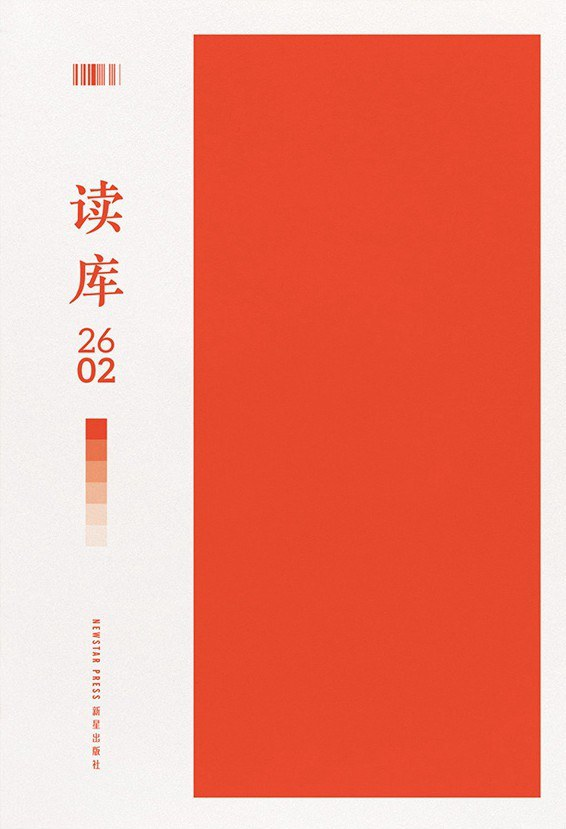
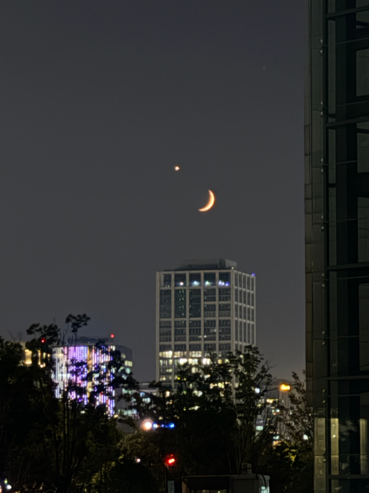
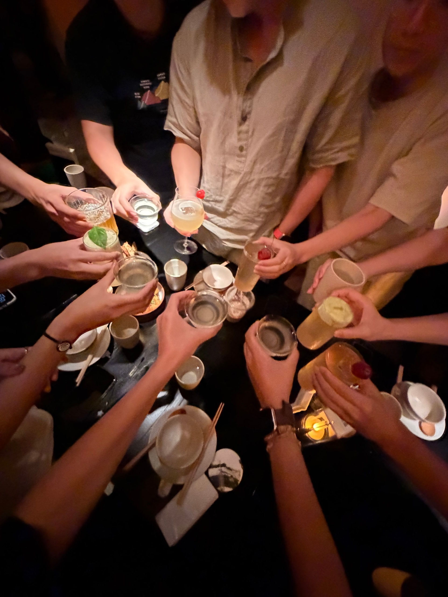
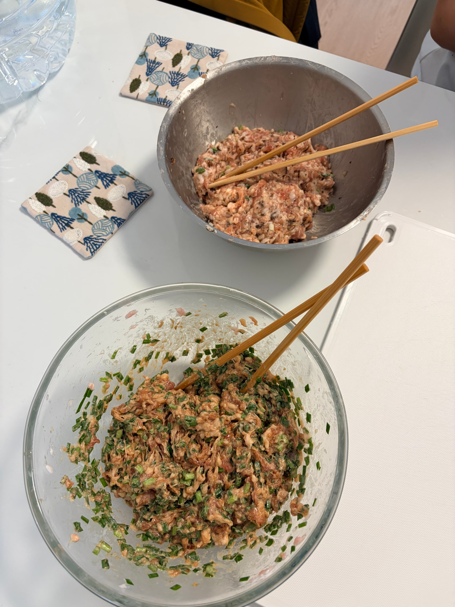
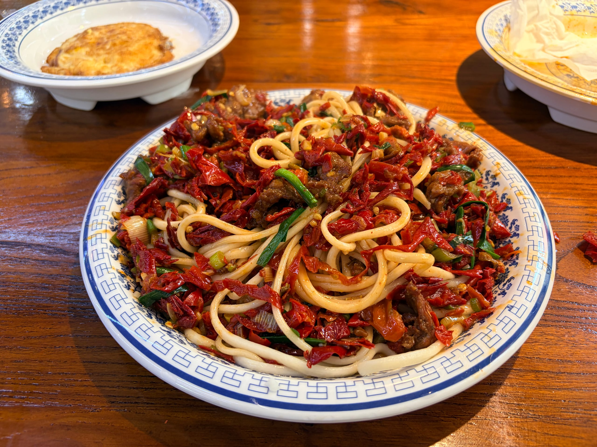

九月，简单的生活，上海有很多好看的晚霞。

## 本月视听读

《[偶像来了](https://movie.douban.com/subject/26261184/)》，十多年前的真人秀。小李闲着翻出来看，而我之前仅看过谢娜模仿各位明星的经典桥段，这是第一次从头看到尾。还真好看！那个时候的节目还找得到真实和生动，哪像现在。

某天洗漱的时候不知道为什么聊到了航空母舰，于是重看《[决战中途岛](https://movie.douban.com/subject/26786669/)》，电视声音放得很大，看得很爽。

月底，读完了《[读库 2602](https://book.douban.com/subject/38427435/)》。前两篇是关于现代诗的，我读不太懂。要是从这一期里挑一篇最喜欢的，几年前的我可能会选《直展，或斜上伸长》，植物学家与植物科学画家父子的故事；现在我却更喜欢医学科普《犯错的柳叶刀》，就像前几期看的诺贝尔奖设立掌故。

## 金秋二三事

逐渐适应了搬家后的通勤。办公室工作周，小李早上会开车送我到比较方便的地铁站，晚上我则是先坐地铁、然后坐四十分钟的公交车。这班公交车，人一般会很少。

居家办公周呢，则是我送他去地铁站，然后回家。对门的大爷每天都支张桌子在楼道里，喝茶看短视频，他也熟悉了我们的通勤节奏。有天他提醒我，说你们不要把楼栋钥匙放在楼下信箱那么显眼的位置，起码要放深一点，或者拿纸盖住一点。

公司楼下，静安公园经过将近一年的修缮，重新开放。中午吃完饭，去转了一圈，我倒感觉没什么大差别。大草坪得以幸存，多了一座假山和瀑布还不错，有高低差、有错落感。但是地砖不知道是质量不好还是怎么，感觉没几天就有点脏了。走道两旁的长椅，右上角有金属铭牌，说是欧莱雅集团捐赠的，他们也在这附近的大楼办公。

九月，小组忙了一年多的项目上线，虽然我的参与程度不高，但还是蹭到了饭。节前最后一个齐聚办公室的周四晚上，我们围着长桌聚餐。产品经理约餐厅，小组老板致辞。就在前一周，因为组里小伙伴离职，我们线上开会道别，也是他俩哭得最凶。

除去调休和中秋假期，九月完整的周末只有两个。小李说，要不包饺子来吃，解解闷，也能储备一些干粮。

他说，我们包两种馅的，一人准备一种。北方人的饺子胜负欲被激发，但是我在老家只包过、吃过，没学过怎么调馅。我还是打开网上的教程，一点又一点地加酱油，舔两口生馅然后呸呸呸吐掉，最后加了致死量的花椒油。

到了包的环节，我说你怎么是那么包的，我在老家是这么包的。其实俩人包的感觉都不是很对。等到热水烧开，小李发出狂笑：你的最先露馅了！

## 辣皮子拌面

中秋当天，合唱团赴新疆演出。这是我第一次去新疆，五个小时的飞机坐得屁股疼。乌鲁木齐街上稍显冷清，主要是没有时差的时差，让人不知道什么时候该吃饭、该睡觉。两天里，我们的演出也安排在了晚上九点开始，近十二点结束。

拌面和抓饭真好吃。连着两天吃了辣皮子拌面、过油肉拌面，觉得此前在上海点的新疆菜外卖都索然无味了。

小李回重庆老家了。两天后，我们回上海，当天晚上再坐长途飞机开启国庆假期的旅行。

动笔写这一篇的时候，我正坐在乌鲁木齐回上海的飞机上。补了觉、吃了早饭，居然还有四小时要熬。
